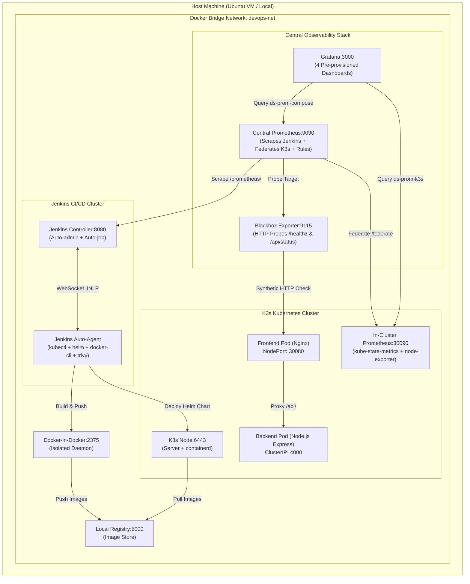

# DevOps Kubernetes & CI/CD Platform - Case Study (Phần 2: Hands-on)

Dự án triển khai nền tảng DevOps hoàn chỉnh, độc lập và chạy hoàn toàn bằng **Docker Compose** . Hệ thống bao gồm: CI/CD Pipeline tự động hóa với **Jenkins**, cụm **K3s (Kubernetes)**, hệ thống đóng gói ứng dụng bằng **Helm**, cùng ngăn xếp giám sát toàn diện **Prometheus + Grafana + Blackbox Exporter**.

- **Repository**: [https://github.com/k-ngn/devops-k8s](https://github.com/k-ngn/devops-k8s)
- **Kiến trúc**: All-in-Docker khép kín (Không phụ thuộc vào host Docker socket `/var/run/docker.sock`).

- **Môi trường Test thực tế**: Ubuntu 24.04 LTS (x86_64, Kernel 6.8+), 4 vCPU, 8GB RAM, 50GB SSD, IP `10.0.1.131`.

### Yêu cầu Hệ thống (System Requirements)
| Hạng mục | Môi trường Đã Kiểm thử | Yêu cầu Tối thiểu (Minimum) | Khuyến nghị (Recommended) |
|---|---|---|---|
| **Hệ điều hành** | Ubuntu 24.04 LTS | Linux x86_64, WSL2, macOS | Ubuntu 22.04 / 24.04 LTS |
| **CPU & RAM** | 4 vCPU, 8GB RAM | 2 vCPU, 4GB RAM | 4 vCPU, 8GB RAM |
| **Dung lượng Ổ cứng** | 50GB SSD | 15GB disk trống | 25GB+ disk trống |
| **Docker Engine** | Docker 27.2 / Compose v2.29 | Docker 24.x+, Compose v2.20+ | Docker Engine 27.x+ |
| **Cổng mạng (Ports)** | Mở 8080, 3000, 9090, 9115, 5000, 6443, 30080, 30090 | Không bị ứng dụng khác chiếm dụng | Firewall không chặn dải 30000-32767 |

---

## 1. Kiến trúc tổng quan (Architecture Overview)



---

## 2. Các Task Đã Hoàn Thành

| Task | Tên Task | Trạng thái | Điểm nhấn kỹ thuật |
|---|---|---|---|
| **Task 0** | **Kubernetes Deployment (BẮT BUỘC)** | ✅ **Done** | Triển khai cụm K3s trong Docker, cấu hình mirror registry inline; Generic Helm Chart (`helm/demo-app`) dùng chung cho Frontend/Backend với probe liveness/readiness, resource limits/requests, rolling update. |
| **Task 1** | **Jenkins CI/CD Pipeline** | ✅ **Done** | `Jenkinsfile` multi-stage declarative; Inbound agent tự động join qua WebSocket CLI; Parallel Linting & Testing; Quét bảo mật Trivy; Triển khai Helm atomic (`--atomic` tự động rollback khi fail); Tự động tạo Job SCM không cần thao tác tay. |
| **Task 3** | **Monitoring & Observability** | ✅ **Done** | Giám sát 3 lớp (Workloads K8s, Jenkins Pipeline, Application Probes); Central Prometheus kết hợp Federation từ K3s; 11 Alert Rules cho Workload/Node/Pipeline; **4 Dashboards tĩnh** chuẩn hóa cho Grafana. |
| **Task 5** | **Production Incident Response** | ✅ **Done** | Kịch bản điều tra & xử lý sự cố tăng CPU / Response time đột biến (SOP logs, metrics, tracing, Helm rollback và preventative HPA/alerts). |

---

## 3. Hướng dẫn chạy (Step-by-Step Quick Start)

### Yêu cầu tiên quyết:
- Máy Linux / Ubuntu / WSL2 có cài đặt **Docker** và **Docker Compose v2+**.
- Cấu hình đề xuất: tối thiểu 4GB RAM, 2 vCPU.

---

### Bước 1: Khởi động toàn bộ nền tảng
Chạy lệnh duy nhất để build và kích hoạt tất cả các container:
```bash
docker compose up -d --build
```

**Quá trình tự động thực hiện:**
- Build Controller với các plugin thiết yếu (`prometheus`, `metrics`, `git`, `workflow-aggregator`), tạo sẵn tài khoản admin và tự tạo pipeline job `demo-app-pipeline`.
- Build Agent và tự động kết nối qua WebSocket tới Controller.
- Khởi tạo cụm K3s gắn sẵn mirror local registry.
- Nạp cấu hình datasource và 4 dashboards tĩnh vào Grafana.

---

### Bước 2: Kiểm tra trạng thái hệ thống
Chờ khoảng 30 giây để các dịch vụ hoàn tất khởi động:
```bash
# Đảm bảo 7 container đều ở trạng thái Running
docker compose ps

# Kiểm tra Jenkins Agent đã kết nối thành công
docker logs jenkins-agent | grep -E "Connected|registered|secret"
```
> Truy cập Jenkins tại `http://<HOST_IP>:8080` (admin / `admin123`). Bạn sẽ thấy job **`demo-app-pipeline`** đã sẵn sàng!

---

### Bước 3: Cài đặt In-Cluster Prometheus cho K3s (Task 3)
Chạy script tự động cài đặt `kube-prometheus-stack` (bản lite gồm Prometheus Server, Kube-State-Metrics và Node-Exporter) lên cụm K3s:
```bash
bash scripts/setup-k3s-monitoring.sh
```

**Kiểm tra pods monitoring trong K3s:**
```bash
docker exec jenkins-agent kubectl get pods,svc -n monitoring
```
*(Tất cả 4 pods `k3s-prom-...`, `kube-state-metrics`, `node-exporter`, `prometheus-0` đều ở trạng thái `1/1 Running`)*.

---

### Bước 4: Chạy CI/CD Multibranch Pipeline triển khai ứng dụng (Task 1 & Task 0)
1. Mở trình duyệt vào Jenkins: `http://<HOST_IP>:8080`.
2. Bạn sẽ thấy project **`demo-app-pipeline`** được thiết lập dưới dạng **Jenkins Multibranch Pipeline** (`WorkflowMultiBranchProject` chuẩn Enterprise).
3. Jenkins tự động quét remote Git repository (`https://github.com/k-ngn/devops-k8s.git`) và khởi tạo các pipeline nhánh con độc lập:
   - **Nhánh `staging`**: Tự động liên kết với Namespace `demo-app-staging`, nạp cấu hình `values-staging.yaml`, mở Frontend tại cổng NodePort `30081`.
   - **Nhánh `main`**: Tự động liên kết với Namespace `demo-app-prod`, nạp cấu hình `values-prod.yaml`, mở Frontend tại cổng NodePort `30080`.
   *(Nếu bạn vừa tạo thêm branch mới trên GitHub, chỉ cần click **"Scan Multibranch Pipeline Now"** ở menu bên trái, Jenkins sẽ tự động lập chỉ mục branch mới trong vài giây)*.
4. **Kích hoạt triển khai**:
   - Nhấp vào nhánh bạn muốn deploy (ví dụ: `staging` hoặc `main`).
   - Bấm **"Build Now"** ở thanh điều hướng bên trái (không cần nhập tham số thủ công, loại bỏ hoàn toàn rủi ro sai sót do con người).
5. Pipeline sẽ thực thi tự động qua các stage:
   - **Checkout & Environment Check**: Jenkins Multibranch tự động checkout đúng commit của branch tương ứng; kiểm tra sẵn sàng của Docker, Helm, Kubectl, Trivy.
   - **Code Quality & Linting** *(Parallel)*: Syntax check backend + Lint Helm chart (`helm lint ./helm/demo-app`).
   - **Test & Build Images** *(Parallel)*: Unit test backend + Build & Push Docker images (`demo-be`, `demo-fe`) lên `registry:5000` với tag `${BUILD_ID}` & `latest`.
   - **Security Scan (Trivy)**: Quét lỗ hổng HIGH/CRITICAL của container image ở chế độ Auditing.
   - **Deploy to K3s via Helm**: Tự động xác định namespace (`demo-app-${targetEnv}`) và file values (`values-${targetEnv}.yaml`), nâng cấp ứng dụng với cờ `--atomic --timeout 3m`.
   - **Verify Rollout**: Xác minh deployment rollout status thành công trong namespace đích.

**Kiểm tra Pods ứng dụng sau khi deploy theo từng môi trường:**
```bash
# Kiểm tra môi trường Staging
docker exec jenkins-agent kubectl get pods,svc -n demo-app-staging

# Kiểm tra môi trường Production
docker exec jenkins-agent kubectl get pods,svc -n demo-app-prod
```

---

### Bước 5: Kiểm tra Ứng dụng & Phân định Môi trường
Hệ thống sử dụng cơ chế NodePort riêng biệt để tránh xung đột cổng:
- **Production Web Portal**: `http://<HOST_IP>:30080`
- **Staging Web Portal**: `http://<HOST_IP>:30081`

Kiểm tra trực tiếp các API endpoint để xác nhận biến môi trường:
```bash
# Production API (trả về environment: "production")
curl -i http://localhost:30080/api/status

# Staging API (trả về environment: "staging")
curl -i http://localhost:30081/api/status
```

---

### Cơ chế Quản lý Biến Môi trường (Environment Variables) & Cách thêm mới

#### 1. Nguyên lý hoạt động
Hệ thống tuân thủ nguyên tắc **The Twelve-Factor App** (tách biệt mã nguồn và cấu hình):
- Generic Helm Chart (`helm/demo-app/templates/deployment.yaml`) định nghĩa:
  ```yaml
  {{- if .Values.env }}
  env:
    {{- toYaml .Values.env | nindent 12 }}
  {{- end }}
  ```
  Toàn bộ danh sách biến trong block `env:` của file values sẽ được Helm tự động chuyển thành biến môi trường của container (`spec.containers[].env`).

#### 2. Cách thêm hoặc điều chỉnh biến môi trường
Để thêm biến môi trường mới (ví dụ: `DATABASE_URL`, `LOG_LEVEL`, `FEATURE_NEW_SEARCH`), kỹ sư chỉ cần khai báo thêm vào file values của môi trường tương ứng:

* **Cho Backend** (`app/backend/values-staging.yaml` và `app/backend/values-prod.yaml`):
  ```yaml
  env:
    - name: PORT
      value: "4000"
    - name: NODE_ENV
      value: "staging"          # hoặc "production"
    - name: APP_ENV
      value: "staging"          # hoặc "production"
    - name: LOG_LEVEL
      value: "debug"            # "info" trên production
    - name: DATABASE_URL
      value: "mongodb://mongo:27017/app"
  ```
  Trong mã nguồn Node.js (`server.js`), ứng dụng truy xuất trực tiếp qua `process.env.DATABASE_URL` hoặc `process.env.APP_ENV`.

* **Cho Frontend** (`app/frontend/values-staging.yaml` và `app/frontend/values-prod.yaml`):
  ```yaml
  env:
    - name: BACKEND_URL
      value: "http://demo-be-demo-app.demo-app-staging.svc.cluster.local:4000"
    - name: APP_ENV
      value: "staging"
  ```
  Container Nginx sử dụng cơ chế `envsubst` tích hợp sẵn của image `nginx:1.27-alpine` để tự động thay thế biến `${BACKEND_URL}` từ file template `/etc/nginx/templates/default.conf.template` vào file cấu hình Nginx khi container khởi động.

---

### Bước 6: Kiểm tra Hệ thống Giám sát & Dashboards (Task 3)

#### 1. Central Prometheus & Alert Rules
- Truy cập `http://<HOST_IP>:9090/targets`:
  - `jenkins` -> **UP** (xanh)
  - `k3s-cluster` (Federation) -> **UP** (xanh)
  - `app-http-probes` -> **UP** (xanh)
- Truy cập `http://<HOST_IP>:9090/alerts`:
  - Đầy đủ các alert rules cho Kubernetes Workload, Node System và Jenkins Pipeline.

#### 2. Grafana Dashboards
- Truy cập `http://<HOST_IP>:3000` (User: `admin` / Pass: `admin123`).
- Vào menu **Dashboards** -> Mở folder **"DevOps Overview"**, bạn sẽ có **4 Dashboards nạp tĩnh**:
  1. **Central DevOps Overview (Working)** (`devops-overview.json`): Dashboard tổng hợp 1 trang mix 2 datasource (`docker-prometheus` & `k3s-prometheus`), hiển thị trực quan:
     - *Application Probes*: HTTP Status Frontend & Backend (Xanh 200 OK), Probe Latency timeseries.
     - *Kubernetes Workloads*: Ready Pods = 2, Pod Restarts = 0, CPU và Memory timeseries.
     - *Jenkins CI/CD Health*: Total Runs, Success Runs, Failed Runs, Queue Size, Executors Busy vs Free.
  2. **K3S cluster monitoring** (ID: 15282): Giám sát hạ tầng Node & Cluster K3s.
  3. **Jenkins: Performance and Health Overview** (ID: 9964): Giám sát chuyên sâu hiệu năng Jenkins Controller.
  4. **Blackbox Exporter (HTTP prober)** (ID: 13659): Giám sát chi tiết latency và DNS/TLS probe.

---

## 4. Bảng thông tin Cổng & Tài khoản truy cập

| Dịch vụ | URL Host | Cổng nội bộ | Tài khoản mặc định | Mô tả |
|---|---|---|---|---|
| **Jenkins Controller** | `http://<IP>:8080` | 8080 | `admin` / `admin123` | Quản lý CI/CD Pipelines |
| **Grafana** | `http://<IP>:3000` | 3000 | `admin` / `admin123` | Dashboard & Trực quan hóa |
| **Central Prometheus** | `http://<IP>:9090` | 9090 | *(Không có)* | TSDB & Cảnh báo Alertmanager |
| **Demo Web App (Production)** | `http://<IP>:30080` | NodePort 30080 | *(Public)* | Giao diện Production (demo-app-prod) |
| **Demo Web App (Staging)** | `http://<IP>:30081` | NodePort 30081 | *(Public)* | Giao diện Staging (demo-app-staging) |
| **Local Container Registry** | `http://<IP>:5000` | 5000 | *(Internal)* | Lưu trữ Docker Images |
| **In-Cluster K3s Prometheus** | `http://<IP>:30090` | NodePort 30090 | *(Internal)* | Scrape Pods/cAdvisor trong K3s |
| **Blackbox Exporter** | `http://<IP>:9115` | 9115 | *(Internal)* | HTTP probe cho ứng dụng |

---

